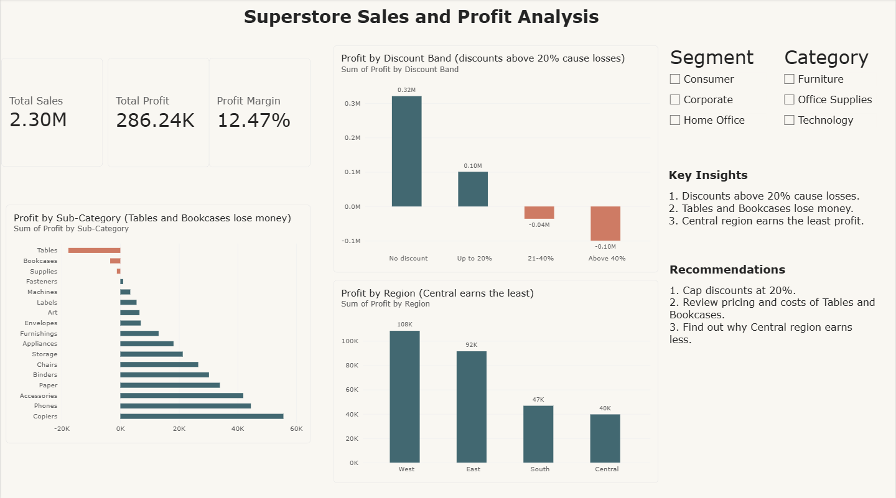

# Superstore Sales and Profit Analysis

Excel and Power BI analysis of a sample retail dataset (9,994 orders) to find why profit is low.

## Goal
Find why the store sells a lot but earns a low profit margin (12.5%), and suggest actions.

## Tools Used
- Excel: Remove Duplicates, IF formula, Pivot Tables
- Power BI: KPI cards, charts, slicers

## Steps
1. Removed 17 duplicate rows (9,977 orders left) and checked for blanks and strange values.
2. Added a Discount Band column using a nested IF formula.
3. Built Pivot Tables for discount, sub-category, region and segment.
4. Built a one-page Power BI dashboard.

## Key Findings
1. Discounts above 20% cause losses.
2. Tables and Bookcases lose money.
3. Central region earns the least profit compared to its sales.
4. Home Office is the most efficient segment (about 14% margin).

## Recommendations
1. Cap discounts at 20%.
2. Review pricing and costs of Tables and Bookcases.
3. Find out why Central region earns less.

## Files
- Superstore_Project.xlsx: cleaned data and Pivot Tables
- Superstore_Dashboard.pbix: Power BI dashboard
- Superstore_Dashboard.png: dashboard screenshot

Note: This uses a sample dataset for practice, not real client data.

## Dashboard

